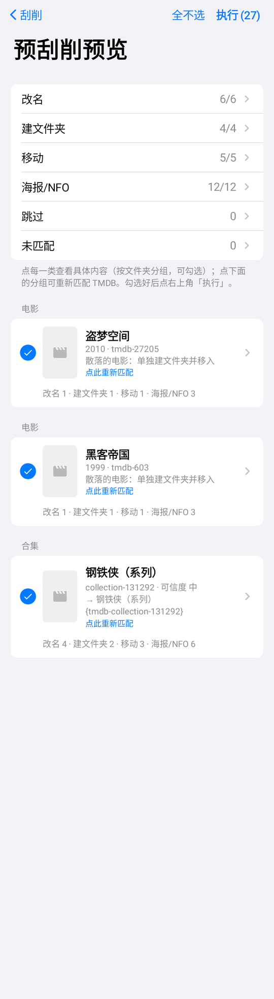
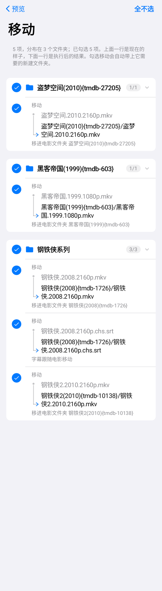
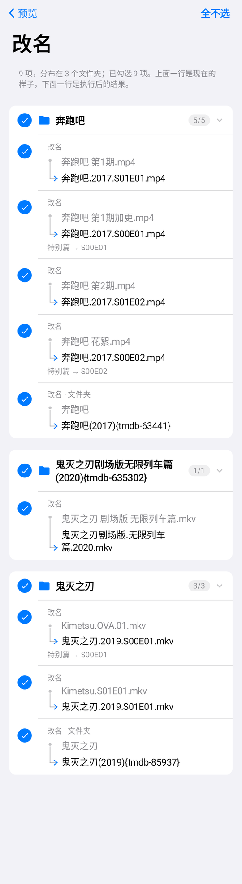
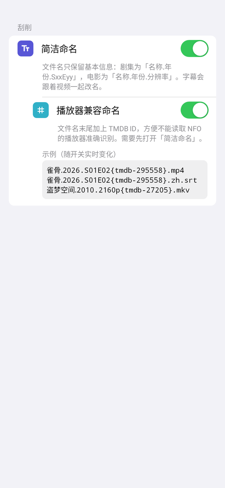

<p align="center"></p>

# PanScraper

[](https://github.com/ALing-lab/PanScraper/releases) [](LICENSE)

用 [TMDB](https://www.themoviedb.org/) 数据整理网盘里的电影和剧集的 Android 应用：改名、整理季文件夹、移动文件、补海报和 NFO，让 Emby / Jellyfin / Kodi / Infuse 等媒体库一眼认出你的片子。

> 所有写操作都要你在「预刮削预览」页确认后才执行；默认不覆盖已有文件，删除操作默认不勾选。

## 支持的网盘

| 网盘 | 改名 / 建文件夹 / 移动 / 上传 | 删除多余文件夹 |
| --- | --- | --- |
| 123 云盘 | ✅ | ✅ 进回收站 |
| 115 网盘 | ✅（作者没有 115，问题请反馈） | ✅ 进回收站 |
| 光鸭云盘 | ✅ | ❌ 需在官方 App 手动删除 |
| WebDAV（群晖 / 威联通 / Alist / OpenList 等） | ✅ | ⚠️ 永久删除（WebDAV 没有回收站） |

## 主要功能

- **扫描与识别**：自动区分分类目录（`剧集`、`电影`、`国产`、`2026` …）和片名文件夹（`雀骨2026`），CJK 片名 + 年份优先匹配；文件名里已有 `{tmdb-ID}` 时直接按 ID 匹配。
- **剧集整理**：单个普通子文件夹直接改名为 `Season N`；多层嵌套时把视频移进季文件夹，剩下的空文件夹可选删除（默认不勾选，会列出里面剩余的文件）。
- **特别篇**：综艺的 `加更 / 花絮 / 彩蛋 / 先导 / 纯享 / 番外`，动漫的 `OVA / OAD / SP` 归入 `Specials`（`S00Exx`）；`剧场版 / Movie` 按电影单独建文件夹。
- **电影合集**：识别 TMDB 合集，按 `合集名{tmdb-collection-ID}/电影名(年份){tmdb-ID}/` 整理，字幕、同名海报、NFO 跟着视频走。
- **散落电影**：同一目录下的多部电影，每部单独建文件夹并移入。
- **命名**：默认保留分辨率、帧率、HDR、音轨（`DDP5.1`、`AAC2.0`、`TrueHD.Atmos`、`DTS-HD.MA5.1`、`FLAC`、`HIFI` …）；可选「简洁命名」（`雀骨.2026.S01E02.mp4`）及其子选项「播放器兼容命名」（`雀骨.2026.S01E02{tmdb-295558}.mp4`）。
- **预览**：按操作类型分页（改名 / 建文件夹 / 移动 / 海报NFO / 删除 / 跳过 / 未匹配），按文件夹分组可折叠，逐项勾选；可对任意分组重新匹配 TMDB（电影 ↔ 剧集）。
- **执行**：分阶段顺序执行（重命名 → 建文件夹 → 移动 → 海报/NFO → 删除），上传失败自动重试；任务页可查看进度 / 成功 / 失败 / 跳过明细，暂停后可继续，失败项可勾选后再次执行。
- **历史记录**：执行成功的项目会记下来，下次扫描自动跳过、不再重复匹配 TMDB（设置里可关闭、可删除）。
- **网络**：TMDB 支持 DoH、代理、图片镜像回退；检查更新走 GitHub Releases。

## 截图

| 预刮削预览 | 移动明细（按文件夹分组） | 特别篇识别 | 命名设置 |
| --- | --- | --- | --- |
|  |  |  |  |

## 下载

到 [Releases](https://github.com/ALing-lab/PanScraper/releases) 下载最新的 `PanScraper-vX.Y.Z.apk`。应用内「设置 → 关于 → 检查更新」也可以直接更新。

## 使用前准备

1. 在 [TMDB](https://www.themoviedb.org/settings/api) 免费申请 API Key（v3）或 Read Access Token。应用 **不内置** 任何密钥，在「设置 → 资源中心 → TMDB 密钥」里填写。
2. 登录网盘账号（凭据只保存在手机本地的加密存储里）。
3. 在「刮削」页选择目录 → 扫描 → 查看预览 → 勾选 → 执行。

## 构建

需要 JDK 17 和 Android SDK（compileSdk 35）。

```bash
./gradlew testDebugUnitTest   # 单元测试 + Robolectric 截图测试
./gradlew assembleDebug       # 输出 app/build/outputs/apk/debug/app-debug.apk
```

`local.properties`、签名文件、`dist/`、日志都已在 `.gitignore` 中排除，请勿提交。

## 作者

- 开发者：ALing-lab · QQ 65646589
- 仓库：https://github.com/ALing-lab/PanScraper · 问题反馈：[Issues](https://github.com/ALing-lab/PanScraper/issues)

## 许可

PanScraper 以 [GNU 通用公共许可证第 3 版（GPL-3.0）](LICENSE) 发布。

```
PanScraper
Copyright (C) 2026 ALing-lab

This program is free software: you can redistribute it and/or modify
it under the terms of the GNU General Public License as published by
the Free Software Foundation, either version 3 of the License, or
(at your option) any later version.

This program is distributed in the hope that it will be useful,
but WITHOUT ANY WARRANTY; without even the implied warranty of
MERCHANTABILITY or FITNESS FOR A PARTICULAR PURPOSE.  See the
GNU General Public License for more details.

You should have received a copy of the GNU General Public License
along with this program.  If not, see <https://www.gnu.org/licenses/>.
```

所用第三方依赖（AndroidX、Jetpack Compose、Kotlin/kotlinx、OkHttp/Okio、Coil、Tink、Gson、LZ4 等为 Apache-2.0，Bouncy Castle 为 MIT）均与 GPL-3.0 兼容，各自许可见应用内「设置 → 关于 → 开源许可」。

本产品使用 TMDB API，但未获得 TMDB 认可或认证。
